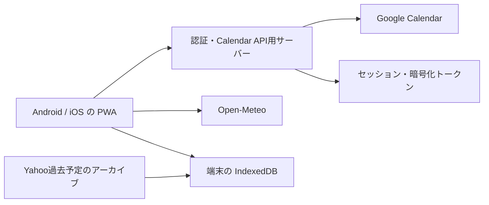

# yy-calendar-app 実装PLAN

作成日: 2026-10-21（日本時間）
状態: 本番構成の提案。操作比較用のPWA・React Native（Expo）モックを実装済み。実機での操作性比較、Google・Yahooの実連携と本番公開は未着手。ウィジェットは未実装。

モックの起動・検証・React Native版との共通シナリオは [README.md](README.md) を参照。利用方式はPWAとReact Native版の操作比較後に確定する。

## 1. 推奨方針

方式はPWAとReact Nativeのモックを実機で比較してから確定する。以下の構成案はPWAを選ぶ場合の案。React + TypeScriptでAndroid・iOS共通の画面を実装し、ホーム画面に追加して使う。Apple Developer Programの年会費と署名更新を避け、Web開発経験を活かせることを優先する。

将来のスマートフォン向けウィジェットも考慮するため、React Native + Expoを並行して評価する。今回のモックはExpo Goで試せる範囲とし、ウィジェットやそのためのネイティブ拡張は作らない。React Nativeを採用する場合は、本番構成とiOSの署名・配布運用を改めて具体化する。

Google Calendarを予定の正本とし、アプリからの作成・編集をGoogleへ反映する。独自の会員登録や夫婦間同期基盤は作らず、Googleへの利用許可と既存のカレンダー共有を利用する。

Google認証を継続利用するため、小さなバックエンドを設ける。サーバーに認証情報を預ける構成になるため、認証とデータ保存の境界を明確にする。

Yahooの過去予定の取得方法は未確定。PC版で閲覧可能という前提で最初に調査し、方法が確立したら閲覧用アーカイブとして取り込む。公式エクスポートがある前提では計画しない。

## 2. 確定した要件

| 項目 | 内容 |
| --- | --- |
| 利用者 | 本人と妻。一般公開しない |
| 対応環境 | Android・iOS。コードベースを共通化 |
| 月表示 | 日曜始まり、左右スワイプで月移動 |
| 日付欄 | 日付・天気アイコン・予定件名を数件表示し、省略件数を示す |
| 日付選択 | 下部にその日の予定一覧と天気詳細を表示 |
| 天気期間 | 今日を含む7日間 |
| 天気詳細 | アイコン、最高・最低気温、降水確率。時間別は不要 |
| 天気地域 | 固定地域。設定で切り替え可能 |
| Google予定 | 複数カレンダー表示、カレンダーごとの色分け、作成・編集の反映 |
| 予定項目 | 開始・終了時刻、件名、終日、日をまたぐ予定、メモ、場所 |
| 繰り返し予定 | 既存予定の表示に対応。作成・編集はGoogle側で行う |
| Yahoo予定 | PC版で閲覧できる過去予定を読み取り専用で扱う |
| オフライン | 保存済みの予定と最後に取得した天気を閲覧 |
| 共有 | Google側のアカウント・共有設定を使う。独自の共有機能は不要 |
| 配布費用 | Appleの年会費を避ける。PWAを検討する |

## 3. 初期版の仮仕様

以下は未回答事項を補う提案であり、利用時の確認に応じて調整する。

- 1端末につきGoogleアカウント1つを接続。そのアカウントが利用できる共有カレンダーも表示する。
- Google側でカレンダーを作成・共有し、アプリでは表示対象と予定の保存先を選ぶ。
- 月グリッドは6週固定を試作し、日付欄は予定を最大2件と「ほかN件」で表示する。下部の一覧には全件表示する。
- 予定の順番は終日、開始時刻、同時刻の場合はカレンダー順・識別子で安定させる。
- 日をまたぐ予定は該当する各日に表示する。月をまたぐ予定も対象。
- 初回は当日を選択。月移動時は当月なら今日、それ以外なら月初を選択する。
- 国内の地域・日本語・摂氏を初期対象とする。天気の日付判定は地域のタイムゾーンで行う。
- 過去・7日先以降には予報を表示しない。過去の実測天気は初期版の対象外。
- Google予定の削除は通常の単発予定に対して確認操作付きで実装する案。不要なら初期版から外せる。
- 通知、週・日表示、スタンプ、ウィジェット、繰り返し予定の編集は初期版の対象外。
- 期限・工数予算は未指定。工程順と完了条件で管理し、技術検証後に見積もる。

## 4. 方式の比較

| 方式 | 今回との適合 | 判断 |
| --- | --- | --- |
| PWA | Web経験を活かせる。ホーム画面起動、月表示、予定編集、オフライン閲覧を共通実装できる | モック実装済み。実機の操作感と配布費用を評価 |
| React Native + Expo | TypeScriptで両OSのアプリを共通開発できる。iOS配布には署名・配布運用が必要 | モック実装済み。操作感と将来のウィジェット対応を含めて評価 |
| Flutter | 共通コードで両OSに対応できるが、DartとUIの学習、iOS配布運用が必要 | 今回は優先度を下げる |

PWAの保存領域はブラウザーやOSによって削除される可能性がある。予定の正本はGoogleに残し、Yahooアーカイブは再取り込みできる元ファイルを別に保管する。アプリ内キャッシュを唯一の保存先にしない。

PWAがバックグラウンドでも常に同期することは約束しない。起動・復帰時、月移動時、手動更新で同期し、閉じていた間の変更は次回利用時に反映する。

## 5. 推奨構成

| 担当 | 技術候補 | 役割 |
| --- | --- | --- |
| 画面 | React + TypeScript + Vite | 月表示、日別一覧、編集フォーム、設定 |
| PWA | vite-plugin-pwa / Workbox | マニフェスト、ホーム画面追加、アプリ本体のオフライン起動 |
| 端末保存 | IndexedDB（Dexie等） | 取得した予定、予報、表示設定、Yahooアーカイブ |
| API | Cloudflare Workers + Hono | OAuth、セッション、Google Calendar APIの呼び出し |
| サーバー保存 | Cloudflare D1 | 許可ユーザー、セッション、暗号化したGoogleトークン |
| 配信 | Workers Static Assets | 画面とAPIを同じオリジンで配信 |
| 天気 | Open-Meteo Forecast API | 7日分の予報。地域検索はGeocoding APIを候補とする |
| 検証 | Vitest + Playwright + 両OS実機 | 日付処理、同期、主要操作、PWA固有の動作 |

1リポジトリでフロントエンド・API・共有の型を管理する。月表示は7列のグリッドとして実装し、日付計算には既存ライブラリを使う。複雑な予定のドラッグ操作や複数日にまたがる帯は初期版に入れない。

予定本文はGoogleから取得して端末に保存し、サーバーのDBには永続保存しない。APIやCDNで個人の予定レスポンスを共有キャッシュしない。Yahooデータも端末に取り込み、Gitや公開する静的ファイルには含めない。

## 6. Google Calendar連携

### 認証

- Google Cloudプロジェクトを用意してCalendar APIとWeb向けOAuthクライアントを設定する。
- サーバーで認可コードを交換し、必要なoffline accessを取得する。Googleの更新トークンやclient secretをブラウザーのlocalStorage等には置かない。
- state検証、対応するフローのPKCE、Secure・HttpOnly Cookie、API書き込み時のOrigin/CSRF対策を実装する。認証には既存のライブラリを使う。
- 許可したGoogleユーザーだけをサーバーで受け入れる。共有アカウント運用ならそのアカウントを、個別運用なら2人のアカウントを登録する。
- 更新トークンは暗号化してD1へ保存し、暗号鍵とclient secretはWorkersのSecretsで管理する。
- OAuth同意画面がExternalのTesting状態だと、Calendar権限を使う更新トークンは7日で期限切れになる。日常利用ではProduction設定と個人利用の審査免除条件を確認する。これはApp Store公開とは別の設定である。
- OAuthの許可撤回やトークン失効時は再接続を案内する。再接続不能でも保存済み予定の閲覧は可能にする。
- iOSホーム画面起動とSafariでは認証・保存領域の扱いを実機検証する。同一画面でのリダイレクトを基本とし、Googleから戻った後に同じ起動形態で利用を続けられるか確認する。

権限候補は `calendar.calendarlist.readonly` と `calendar.events`、本人識別用の `openid` / `email`。カレンダー共有設定の変更権限は要求しない。広すぎる `calendar` 権限は避ける。

### 読み込みと更新

- CalendarListから一覧・色・アクセス権を取得し、表示対象を選択する。
- 月グリッドに含まれる前後月の日付も取得範囲に含める。
- `singleEvents=true`で既存の繰り返し予定を展開し、変更・キャンセルされた回もAPIの応答に沿って表示する。ページネーションを全件処理する。
- 初期版は表示範囲の再取得で同期する。取得成功後、範囲内のキャッシュをトランザクションで置き換え、削除済み予定も消す。失敗・途中ページ取得時には既存キャッシュを残す。
- 初回は当月と前後月を保存し、以後開いた月も保存する。未取得の月はオフラインで「未取得」と表示し、「予定なし」と区別する。
- 起動・復帰時と手動更新で再取得。Google側の変更は更新後に反映する。差分同期・Webhookは初期版で導入しない。
- 作成・編集はオンライン時のみ。保存成功後にGoogleの確定データを反映する。通信失敗時は入力を維持し、未保存と示す。
- 作成時には安定したリクエスト識別子／イベントIDを利用し、応答不明時の再試行で予定が重複しないようにする。
- 編集は変更したフィールドだけを送信し、参加者・会議情報・リマインダーなど未対応の情報を保持する。
- etagによる条件付き更新で競合を検出し、Google側で他の編集があれば最新版の確認を促す。自動上書きしない。
- 閲覧権限のみのカレンダー、Yahoo予定、繰り返し予定には編集操作を出さない。繰り返しはGoogleで編集する案内を出す。
- 終日は日付型、時刻付き予定は日時とタイムゾーンとして扱う。終了境界は排他的に計算し、終日や深夜0時終了の予定が翌日へ余計に表示されないようにする。
- 保存キーはGoogleユーザー・calendarId・eventIdの組とする。ログアウト／別アカウント接続時は予定キャッシュを消去して取り違えを防ぐ。

## 7. 天気

- 保存する地域情報は表示名、緯度・経度、タイムゾーン。GPS権限は要求せず、地域検索・選択で設定する。
- `forecast_days=7`、地域のタイムゾーン、日次の `weather_code`、`temperature_2m_max`、`temperature_2m_min`、`precipitation_probability_max` を候補として取得する。
- 日付欄に天気アイコン、下部にアイコン・最高／最低気温・降水確率を表示する。
- Open-Meteoの降水確率は日内最大値を採用し、詳細でその定義がわかるようにする。Yahooと同じ予報値になることは前提にしない。
- データは地域ID・タイムゾーン・予報対象日で保存し、取得日時も保持する。地域を切り替えたとき、前の地域の値を混ぜない。
- 起動・復帰・地域変更時に更新する。自動更新の間隔は3時間程度を初期案とし、手動更新を用意する。
- 日付が変わったら表示対象を再計算する。古い予報の配列を新しい日付へずらして表示しない。
- 通信失敗時は同じ地域・同じ対象日の保存済み予報を取得日時付きで表示する。欠損値は「—」にし、0%・晴れ等に置き換えない。
- 天気が取得できなくても予定の表示は続ける。Open-Meteoへの出典リンクを天気表示の近くに配置する。

## 8. Yahooの過去予定：先行調査が必要

2026-10-21時点で確認した公式ヘルプでは、Yahoo!カレンダーにエクスポート・インポート機能はない。PC版で過去予定を閲覧できることだけでは、自作アプリでの取得可否は確定しない。

1. 本人のPC版で過去予定の範囲・件数、表示項目、利用可能な公式の取得・印刷・連携方法を確認する。
2. 既存のバックアップや端末同期済みデータがある場合は、そこから取り出せるか確認する。
3. 正規に利用できる取得手段があるか、必要ならサポートへの問い合わせ内容を整理する。問い合わせの送信は別途依頼を受けて行う。
4. 取得できる場合は、一度取り出す変換処理と、読み取り専用の取り込み処理を作る。元データも保存する。
5. 件名、日時、終日、複数日、メモ、場所、文字コード、繰り返しの展開範囲、移行漏れ・重複を検証する。

アーカイブには形式バージョン、元サービス、取得期間、取得日時、識別子を付け、再取り込みを安全に行えるようにする。夫婦それぞれの端末に同じ元ファイルから取り込めるようにする。

取得方法が見つからない場合、Yahoo予定のアプリ内閲覧は未達要件として残す。PC版へのリンクだけで要件を満たしたことにはしない。手入力で必要分を保存する案や、PC版で閲覧し続ける案は代替案として判断する。

## 9. オフラインとPWA更新

- Service Workerでアプリ本体とローカルの天気アイコン等を保存する。認証エンドポイントや個人APIは自動キャッシュ対象から除外する。
- 予定・予報はアカウント等で区別したIndexedDBに保存する。読み込み済みデータを先に表示してからオンラインで更新する。
- 通信状態、最後の同期時刻、未取得と取得済み空データを区別する。権限エラーや接続エラーを「予定なし」と表示しない。
- オフライン編集・後送信キューは初期版では作らない。
- 更新版のService Workerが届いても、予定入力中に強制再読み込みしない。更新可能な状態を示して適用する。
- ブラウザーの容量不足・保存失敗を処理する。対応環境では永続ストレージを要求するが、保存の保証とは扱わない。
- Yahooアーカイブはブラウザー外へ保管した元ファイルから復旧可能にする。キャッシュ削除や機種変更後の復旧手順を用意する。

## 10. 開発順と完了条件

| 工程 | 作業 | 完了条件 |
| --- | --- | --- |
| 0. 技術検証 | 最小PWA、実際のGoogle認証、Yahoo取得調査、対象端末・OSの記録 | Android・iOSのホーム画面起動からGoogle接続・再起動・トークン更新・1件取得ができる。Yahoo取得可否と次の対応が明確になる |
| 1. 画面試作 | 仮データで月表示、スワイプ、選択日、日別一覧、予定フォーム | 6週の月、予定多数、終日・複数日でも日付欄と下部一覧が使いやすい |
| 2. Google閲覧 | カレンダー選択・色分け・範囲取得・繰り返し表示・キャッシュ | Google側の登録・変更・削除が更新後に反映され、失敗時も保存済みデータが残る |
| 3. 天気 | 地域選択・7日予報・アイコン・詳細・出典・保存 | 月またぎ、日付変更、地域変更、通信失敗、欠損値で誤った日付・地域の予報が出ない |
| 4. Google編集 | 単発予定の作成・編集、削除を採用する場合は削除も実装 | Googleと相互確認できる。閲覧権限・競合・再試行・未対応フィールド保持を確認できる |
| 5. Yahoo移行 | 工程0で確立した方法で抽出・変換・読み取り専用取り込み | 取得対象の期間・件数と内容を照合でき、再取り込みと復旧が可能。方法未確立なら未達として残す |
| 6. 夫婦で試用 | オフライン起動、PWA更新、ホーム画面追加、ログアウト、実機調整 | 両端末で日常操作を試し、表示・認証・同期・復旧の問題を修正する |

工程0のYahoo調査はPWAの技術検証と並行して進められる。Yahooの調査結果によっては工程5を先に実施し、データ保全を優先する。Googleへの実際の書き込み検証には専用のテストカレンダーを使う。

## 11. 重点的に検証するケース

- 月末から翌月にまたがる7日予報、年またぎ、うるう年、6週必要な月。
- 終日の終了日、月またぎの複数日予定、深夜0時終了、予定の元タイムゾーンと表示日の違い。
- 繰り返し予定の通常回・変更回・キャンセル回、閲覧専用の共有カレンダー。
- Googleのページネーション、他の端末での編集・削除、競合、応答不明後の再保存。
- オフラインでの起動・月移動・地域変更、Google認証失効、天気API失敗、部分データ。
- iOS Safariからの利用とホーム画面PWAからの利用、Android ChromeのPWA、認証から戻る動作。
- 別アカウントへの切り替え、共有端末でのログアウト、Yahoo再取り込み。
- 小さい画面、文字サイズ変更、タップ領域、予定一覧の縦スクロールと月スワイプの干渉。

日付・同期の重要な分岐は単体テスト、主要操作はブラウザーE2Eで確認する。PWAのインストール・認証復帰・保存領域はエミュレーションだけで済ませず実機で確認する。

## 12. 費用・運用

- PWA案ではApple Developer Programやストア登録を利用しない。
- Open-Meteoは非商用の無料APIを利用する案。出典表示を実装する。
- Workers・D1は無料枠を第一候補とする。夫婦2人の通常利用なら無料枠内を目指せる見込みだが、実際の使用量・実行制限と料金を確認する。
- HTTPS配信先とOAuthリダイレクトURIを先に決める。ドメインの登録要件を技術検証で確認し、必要なら取得済みドメインを使う。新規独自ドメインが必要な場合は別途費用となる。
- 個人利用のGoogle OAuth審査免除を使う場合、未確認アプリの画面が表示される可能性を把握する。Testingのまま日常運用しない。
- API上限、OAuth失効、依存ライブラリ更新、Yahoo元ファイルの保管を運用項目とする。エラーログに予定本文やトークンを記録しない。

## 13. 実装前に残る判断

- ご夫婦の具体的な端末・OSバージョン。工程0のテスト対象を確定する。
- Yahooアーカイブを何年分・どのカレンダーまで残すか。取得方法とセットで確定する。
- Googleアカウントを共有して接続するか、各自のアカウントで共有カレンダーを読むか。
- Google更新トークンを小さな自前バックエンドで保管する提案と、配信先の選定。
- 削除機能、祝日表示、デフォルト保存先、初期地域。画面試作の段階で決める。

## 14. 公式情報・一次資料

確認日: 2026-10-21。利用条件やAPI仕様は実装時にも確認する。

- [Apple: iPhoneでWebサイトをホーム画面のWebアプリとして使う](https://support.apple.com/en-lamr/guide/iphone/iphea86e5236/ios)
- [Web.dev: PWAのオフラインデータとストレージ](https://web.dev/learn/pwa/offline-data?hl=en)
- [Google: Webサーバー向けOAuth](https://developers.google.com/identity/protocols/oauth2/web-server)
- [Google: OAuthのトークン期限・Testingの制限](https://developers.google.com/identity/protocols/oauth2/)
- [Google: 個人利用など審査が不要な場合](https://support.google.com/cloud/answer/13464323?hl=en)
- [Google Calendar: 権限スコープ](https://developers.google.com/workspace/calendar/api/auth)
- [Google Calendar: 予定一覧](https://developers.google.com/workspace/calendar/api/v3/reference/events/list)
- [Google Calendar: etagによる条件付き更新](https://developers.google.com/calendar/api/guides/version-resources)
- [Yahoo: エクスポート・インポート機能について](https://support.yahoo-net.jp/PccCalendar/s/article/H000013400)
- [Yahoo: バックアップ・移行と2026年9月28日のリニューアル案内](https://support.yahoo-net.jp/SaaCalendar/s/article/H000009192)
- [Open-Meteo: Forecast API](https://open-meteo.com/en/docs?past_days=1)
- [Open-Meteo: 料金・出典表示](https://open-meteo.com/en/pricing)
- [Cloudflare: React + Vite構成](https://developers.cloudflare.com/workers/framework-guides/web-apps/react/)
- [Cloudflare: Workers料金](https://developers.cloudflare.com/workers/platform/pricing/)
- [Cloudflare: D1料金](https://developers.cloudflare.com/d1/platform/pricing/)
- [Vite PWA: 導入ガイド](https://vite-pwa-org.netlify.app/guide/)
- [Expo: 内部配布の制約](https://docs.expo.dev/build/internal-distribution/)
- [Apple: Developer Programの年会費](https://developer.apple.com/help/account/membership/program-enrollment/)
